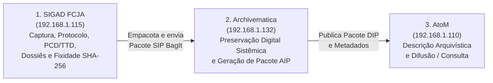

# Guia Oficial de Operação e Referência Completa — SIGAD FCJA

**Sistema Informatizado de Gestão Arquivística de Documentos da Fundação Casa de José Américo (FCJA)**  
**Projeto Vinculado:** Repositório Arquivístico Digital Confiável da produção do Projeto Preservação e Difusão do Acervo da FCJA (`BR-PBFCJA-RADC`)

---

## Sumário

1. [Apresentação Institucional e Visão Geral do Sistema](#1-apresentação-institucional-e-visão-geral-do-sistema)
2. [O Ecossistema Digital da Fundação (SIGAD → Archivematica → AtoM)](#2-o-ecossistema-digital-da-fundação-sigad--archivematica--atom)
3. [Acesso ao Sistema, Credenciais e Perfis de Permissão (RBAC)](#3-acesso-ao-sistema-credenciais-e-perfis-de-permissão-rbac)
4. [Dicionário Completo do Sistema: O Que Cada Termo e Campo Significa](#4-dicionário-completo-do-sistema-o-que-cada-termo-e-campo-significa)
5. [Guia Detalhado Tela por Tela (As 7 Abas do Sistema)](#5-guia-detalhado-tela-por-tela-as-7-abas-do-sistema)
   - [5.1. Aba 1 — Dashboard Analítico](#51-aba-1--dashboard-analítico)
   - [5.2. Aba 2 — Explorador do Acervo](#52-aba-2--explorador-do-acervo)
   - [5.3. Aba 3 — Captura & Acervo (Central de Trabalho)](#53-aba-3--captura--acervo-central-de-trabalho)
   - [5.4. Aba 4 — PCD, TTD & Dossiês (Gestão Arquivística)](#54-aba-4--pcd-ttd--dossiês-gestão-arquivística)
   - [5.5. Aba 5 — Conector Archivematica (Recolhimento OAIS)](#55-aba-5--conector-archivematica-recolhimento-oais)
   - [5.6. Aba 6 — Auditoria & Fixidade (Governança e Termos)](#56-aba-6--auditoria--fixidade-governança-e-termos)
   - [5.7. Aba 7 — Gerenciar Acessos (Administração RBAC)](#57-aba-7--gerenciar-acessos-administração-rbac)
6. [Modais e Janelas Especializadas (Explicação Detalhada)](#6-modais-e-janelas-especializadas-explicação-detalhada)
7. [Tabelas de Referência Institucional (Núcleos, Siglas e Classes Finalísticas)](#7-tabelas-de-referência-institucional-núcleos-siglas-e-classes-finalísticas)
8. [Roteiros Práticos do Dia a Dia (Passo a Passo Rápido)](#8-roteiros-práticos-do-dia-a-dia-passo-a-passo-rápido)
9. [Perguntas Frequentes (FAQ) e Solução de Problemas](#9-perguntas-frequentes-faq-e-solução-de-problemas)

---

## 1. Apresentação Institucional e Visão Geral do Sistema

O **SIGAD FCJA** é o **Sistema Informatizado de Gestão Arquivística de Documentos** da **Fundação Casa de José Américo**. Diferente de um simples repositório de arquivos ou de um GED comum, o SIGAD FCJA controla todo o **ciclo de vida documental** desde a sua produção/captura até a sua destinação final (guarda permanente ou eliminação controlada), garantindo:

* **Autenticidade e Fixidade Criptográfica:** Cada arquivo capturado recebe um número único de protocolo e tem sua impressão digital matemática (`Hash SHA-256`) calculada e monitorada continuamente.
* **Relação Orgânica:** Os documentos podem ser agrupados em **Dossiês** ou **Processos** que refletem as pesquisas e ações culturais da Fundação.
* **Classificação e Temporalidade Automática:** Integra tanto o Plano de Classificação de **Atividades-Meio** do Estado da Paraíba (PCDM/APEPB) quanto o Plano de Classificação de **Atividades-Fim** da própria FCJA, calculando automaticamente os prazos de guarda.
* **Rastreabilidade e Auditoria Imutável:** Todas as operações (captura, edição de metadados, verificação de integridade, abertura de dossiês, eliminação e transferência ao Archivematica) ficam registradas em uma trilha de auditoria perpétua.
* **Zero Retrabalho na Preservação:** Os metadados preenchidos no momento do cadastro são empacotados automaticamente no padrão internacional **OAIS / BagIt** para envio direto ao **Archivematica**, eliminando a necessidade de redigitar informações.

### Formatos Aceitos e Limites Técnicos
* **Extensões suportadas na captura:**
  * `PDF` (`.pdf`) — Textos, relatórios, dossiês digitalizados, ofícios, notas fiscais.
  * `Word` (`.docx`) — Textos em elaboração, minutas, relatórios técnicos.
  * `Excel / Planilhas` (`.xlsx` e `.csv`) — Inventários, levantamentos de dados, controles financeiros.
  * `TIFF` (`.tiff` / `.tif`) — Matrizes digitais fotográficas e iconográficas de alta resolução para preservação.
* **Tamanho máximo por arquivo:** Até **25 MB** por componente digital.
* **Validação de segurança:** O servidor inspeciona a assinatura binária real (*magic bytes*) de cada arquivo enviado, impedindo que arquivos executáveis ou corrompidos disfarçados com outra extensão entrem no acervo.

---

## 2. O Ecossistema Digital da Fundação (SIGAD → Archivematica → AtoM)

A infraestrutura do **Repositório Arquivístico Digital Confiável (RDC-Arq)** da Fundação Casa de José Américo é composta por três sistemas integrados que atuam em cadeia na rede local:

### Quadro Geral de Endereços na Rede Local da FCJA

| Sistema | Papel Arquivístico | Endereço Principal na Rede |
| :--- | :--- | :--- |
| **SIGAD FCJA** | Porta de entrada do acervo: captura, classificação, gestão de dossiês, temporalidade, auditoria e geração de pacotes SIP | `http://192.168.1.115` *(Contingência: `http://192.168.1.110:8085`)* |
| **Archivematica** | Processamento de preservação digital de longo prazo e armazenamento de pacotes permanentes (**AIP**) | `http://192.168.1.132` |
| **Storage Service** | Gerenciamento de áreas de armazenamento e transferência do Archivematica | `http://192.168.1.132:8000` |
| **AtoM** | Portal de descrição arquivística multinível e difusão pública de pacotes de acesso (**DIP**) | `http://192.168.1.110` |

---

## 3. Acesso ao Sistema, Credenciais e Perfis de Permissão (RBAC)

### 3.1. Como Entrar no Sistema (Tela de Login)
1. Conecte seu computador ou notebook à **rede interna da Fundação** (via cabo ou Wi-Fi institucional).
2. Abra qualquer navegador atualizado (Chrome, Edge, Firefox ou Brave) e acesse **`http://192.168.1.115`**.
3. Na tela central **SIGAD FCJA**, preencha:
   * **Usuário (Identificador):** Seu login institucional (ex.: `antonio`, `barbara`, `andre`, `pablo`, `josilene`).
   * **Senha de Acesso:** Sua senha pessoal.
4. Clique no botão azul **Entrar no Sistema**.

### 3.2. Os 3 Perfis de Permissão do Sistema (Governança RBAC)

O SIGAD FCJA utiliza **Controle de Acesso Baseado em Papéis (RBAC)**. Cada membro da Fundação possui um perfil que define exatamente quais operações estão liberadas:

| Perfil no Sistema | Quem Utiliza | O Que Pode Fazer | Restrições de Segurança |
| :--- | :--- | :--- | :--- |
| **Pesquisador FCJA** (`pesquisador`) | Pesquisadores e bolsistas dos núcleos de pesquisa | • Acessar o Dashboard e Explorador; • Capturar (fazer upload) de documentos; • Abrir Dossiês e juntar documentos; • Visualizar, baixar e exportar relatórios; • Retificar metadados descritivos; • Descartar rascunhos com status **`MINUTA`**. | **Bloqueio de Imutabilidade:** Não pode excluir documentos oficiais (`ORIGINAL` ou `CÓPIA`), não pode alterar a Tabela de Temporalidade e não pode emitir pacotes SIP ou Termos de Eliminação. |
| **Arquivista SIGAD** (`arquivista`) | Arquivistas, coordenadores de preservação e comissão de avaliação (CPAD) | Tudo o que o Pesquisador faz, **mais**: • Cadastrar e ativar/inativar classes no PCD/TTD; • Executar Auditoria de Fixidade SHA-256 em lote; • Autorizar a eliminação de documentos oficiais mediante emissão de **Termo de Eliminação**; • Construir e enviar pacotes **SIP** para o Archivematica e consolidar **AIPs**. | Não gerencia o cadastro de usuários/senhas (exclusivo do Administrador). |
| **Administrador Geral** (`admin`) | Coordenação de TI e Administração Geral do Repositório | **Acesso Total e Irrestrito** a todos os módulos operacionais, arquivísticos, conectores e à aba exclusiva **Gerenciar Acessos** (criação de contas, redefinição de senhas e alteração de perfis RBAC). | Nenhuma restrição no sistema. |

### 3.3. Credenciais Iniciais Cadastradas

| Membro da Equipe | Usuário (Login) | Senha Inicial | Perfil Inicial |
| :--- | :--- | :--- | :--- |
| **Antonio** | `antonio` | `1980` | Administrador Geral |
| **Bárbara** | `barbara` | `1980` | Pesquisador FCJA |
| **André** | `andre` | `1980` | Pesquisador FCJA |
| **Pablo** | `pablo` | `1980` | Pesquisador FCJA |
| **Josilene** | `josilene` | `1980` | Pesquisador FCJA |

---

## 4. Dicionário Completo do Sistema: O Que Cada Termo e Campo Significa

Para utilizar o sistema com segurança, compreenda o significado exato de cada conceito exibido nas telas:

### 4.1. Identificação e Proveniência
* **Protocolo SIGAD (NUP — Número Único de Protocolo):**  
  Código único e automático gerado pelo sistema no instante em que um documento é capturado.  
  *Formato:* `FCJA.<SIGLA_CURTA_NUCLEO>.<ANO>.<SEQUENCIAL>` (Exemplo: `FCJA.NMJAA.2026.00001`). Garante que nenhum documento seja confundido, mesmo que dois arquivos tenham o mesmo nome.
* **Núcleo Produtor:**  
  O núcleo de pesquisa ou setor da Fundação responsável pela produção ou acumulação daquele documento.
* **Sigla NOBRADE:**  
  Código padronizado segundo a Norma Brasileira de Descrição Arquivística que identifica hierarquicamente o fundo/subfundo/setor da FCJA (Exemplo: `BR_PB_FCJA_GEDA_GOP_PPMD_NMJAA`). É preenchido automaticamente assim que você escolhe o Núcleo Produtor.
* **Autor / Entidade Produtora:**  
  Pessoa física, pesquisador ou instituição que produziu intelectualmente o documento (Por padrão: `Fundação Casa de José Américo (FCJA)` ou o nome do pesquisador/autor).

### 4.2. Maturidade e Status do Documento
* **`Original (Capturado Oficial)` (`ORIGINAL`):**  
  Documento finalizado, revisado e incorporado oficialmente ao acervo da Fundação. **Regra de Ouro:** Uma vez capturado como `Original`, ele torna-se imutável para pesquisadores e só pode ser removido por um Arquivista ou Administrador mediante justificativa formal e geração de um **Termo de Eliminação**.
* **`Minuta / Rascunho de Pesquisa` (`MINUTA`):**  
  Documento ainda em fase de elaboração, versão preliminar ou rascunho de trabalho. Enquanto estiver com o status `Minuta`, o próprio pesquisador pode descartá-lo caso necessário.
* **`Cópia Simples / Referência` (`COPIA`):**  
  Reprodução de documento ou material bibliográfico/arquivístico de apoio utilizado como referência pelo núcleo.

### 4.3. Sigilo e Restrição de Acesso (LAI e LGPD)
* **`Ostensivo (Acesso Público / Livre)` (`OSTENSIVO`):**  
  Documento sem restrições legais de visualização, apto à difusão pública futura no portal AtoM.
* **`Restrito — Informação Pessoal (LGPD)` (`RESTRITO_LGPD`):**  
  Documento que contém dados pessoais sensíveis (CPF, RG, endereço residencial, dados bancários, informações médicas ou de terceiros protegidos pela Lei Geral de Proteção de Dados — Lei nº 13.709/2018).
* **`Sigiloso — Restrição Legal (LAI)` (`SIGILOSO_LAI`):**  
  Documento sujeito a restrição temporária de acesso conforme a Lei de Acesso à Informação (Lei nº 12.527/2011), direitos autorais patrimoniais não cedidos ou segurança do acervo.
* **Hipótese Legal de Restrição:**  
  Campo obrigatório sempre que o documento for marcado como `Restrito (LGPD)` ou `Sigiloso (LAI)`. Nele você deve informar o motivo legal da restrição (ex.: *"Art. 31 da Lei 12.527/2011 — Contém dados pessoais de entrevistados"*).

### 4.4. Organização Arquivística: Dossiês, Atividades e Temporalidade
* **Unidade de Arquivamento (`Dossiê` ou `Processo`):**  
  Uma "pasta arquivística lógica" numerada (ex.: `DOS-2026-0001`) que reúne vários documentos diferentes (ex.: um plano de trabalho + uma planilha de inventário + um relatório final) que pertencem a uma mesma pesquisa ou ação cultural. Essa ligação entre os documentos chama-se **Relação Orgânica** ou **Vínculo Arquivístico**.
* **Documento Avulso:**  
  Documento que foi capturado individualmente sem estar amarrado imediatamente a um Dossiê (ele pode ser juntado a um Dossiê a qualquer momento depois).
* **Escopo de Atividade (`Atividade-Meio` vs. `Atividade-Fim`):**
  * **Atividade-Meio:** Atividades de apoio administrativo, financeiro, logístico, compras, recursos humanos e gestão interna (classificadas pela tabela estadual PCDM/APEPB — Funções 1 a 7).
  * **Atividade-Fim (FCJA):** Atividades que constituem a missão finalística da Fundação Casa de José Américo: pesquisa histórica, literária, memória musical, audiovisual, arqueologia, educação patrimonial e preservação digital (Funções 100, 200 e 300).
* **Tabela de Temporalidade de Documentos (TTD):**
  Define por quanto tempo o documento fica em cada fase antes do seu destino final:
  * **Fase Corrente:** Período (em anos) em que o documento é consultado frequentemente pela equipe que o produziu.
  * **Fase Intermediária:** Período (em anos) em que o documento já não é usado no dia a dia, mas aguarda prazos legais ou precaucionais.
  * **Destinação Final:** O que acontece após vencerem os prazos:
    1. **`Guarda Permanente (RDC-Arq)`:** O documento jamais será eliminado; seu destino é ser empacotado em um **SIP** e recolhido ao **Archivematica** para preservação eterna. *(Todos os documentos de Atividade-Fim da FCJA têm Guarda Permanente automática).*
    2. **`Eliminação Controlada` (Guarda Temporária):** Documentos administrativos rotineiros que, após cumprirem seu prazo legal de guarda, podem ser descartados mediante Termo de Eliminação oficial.

### 4.5. Preservação Digital (PREMIS, SHA-256, SIP, AIP e DIP)
* **Hash SHA-256 (Fixidade PREMIS):**  
  É um código hexadecimal de 64 caracteres (ex.: `a3f5c8...91b2`) calculado a partir de cada bit do arquivo no momento do upload. Se uma única vírgula ou pixel do arquivo for alterado ou corrompido no disco do servidor anos depois, o cálculo dará um resultado diferente e o sistema acusará **Violação de Fixidade**.
* **Pacote SIP (*Submission Information Package* — Pacote de Submissão):**  
  Pacote padronizado no formato **BagIt (RFC 8493)** gerado pelo SIGAD FCJA contendo os arquivos digitais + `metadata.csv` + histórico de auditoria `premis_events.json` + manifesto `mets_earq_manifest.xml` pronto para ser engolido pelo Archivematica.
* **Pacote AIP (*Archival Information Package* — Pacote de Arquivamento):**  
  O pacote final de preservação permanente gerado pelo **Archivematica** após normalizar e validar o SIP enviado pelo SIGAD. Identificado por um código universal (`AIP UUID`).
* **Pacote DIP (*Dissemination Information Package* — Pacote de Difusão):**  
  A versão derivada gerada para publicação e consulta pública no sistema **AtoM**.

---

## 5. Guia Detalhado Tela por Tela (As 7 Abas do Sistema)

A barra lateral esquerda (escura) está sempre visível e permite alternar entre os módulos do sistema, além de exibir no rodapé o **Agente conectado**, seu **Perfil RBAC** e o botão vermelho **Sair do Sistema**.

---

### 5.1. Aba 1 — Dashboard Analítico

Oferece uma visão executiva e estatística em tempo real sobre todo o acervo armazenado no servidor da Fundação.

#### Cartões de Indicadores (Topo)
1. **Total no Acervo:** Número total de documentos registrados e ativos no banco de dados.
2. **Tamanho do Acervo:** Soma exata do espaço em disco ocupado pelos arquivos cadastrados no SIGAD (em KB, MB ou GB).
3. **Espaço Utilizado:** Volume total ocupado na partição principal de armazenamento (SSD/HD) do servidor Ubuntu da Fundação.
4. **Espaço Livre:** Capacidade livre disponível no servidor para novos uploads.

#### Gráficos Interativos (Centro)
* **Distribuição por Núcleo de Pesquisa (Gráfico de Rosca):** Mostra a proporção de documentos produzidos por cada núcleo de pesquisa. Passe o mouse sobre as fatias para ver os números exatos.
* **Volume de Documentos por Ano (Gráfico de Barras Verticais):** Compara a quantidade de documentos produzidos em cada ano (`2022` a `2027`).
* **Distribuição por Tipologia Documental (Gráfico de Barras Horizontais):** Exibe o ranking das espécies/tipologias mais frequentes no acervo (Relatórios, Planilhas, Ofícios, Notas Fiscais, etc.).

#### Botão "Filtros Avançados" (Canto Superior Direito)
Ao clicar neste botão, abre-se a janela **Filtros do Dashboard**, permitindo refinar os gráficos por:
* **Filtro de Pastas (PCDM):** Permite filtrar os gráficos por uma Função, Subfunção, Atividade ou Código específico do Plano de Classificação.
* **Tipologias:** Caixa de seleção múltipla com todas as tipologias documentais.
* **Núcleo de Pesquisa:** Filtra os indicadores para um único núcleo específico ou `Todos`.
* **Ano Inicial e Ano Final:** Define o recorte cronológico desejado.
* **Etiquetas de Filtro Ativo (*Filter Chips*):** Quando qualquer filtro é aplicado, pequenas etiquetas aparecem abaixo do título da tela. Você pode remover um filtro específico clicando no `X` da etiqueta ou clicar em **Limpar filtros** para voltar à visão completa.

---

### 5.2. Aba 2 — Explorador do Acervo

Simula um gerenciador de pastas de computador (como o Windows Explorer), refletindo exatamente como os arquivos estão organizados por diretórios no servidor.

#### Painel Esquerdo: Diretórios Raiz
* **Armazenamento no Servidor:** Lista todos os documentos do servidor de uma só vez.
* **Lista dos 16 Núcleos de Pesquisa:** Clique em qualquer núcleo para abrir sua estrutura de pastas no painel direito.

#### Painel Direito: Navegação Hierárquica em 3 Níveis
A navegação segue sempre a hierarquia **Núcleo > Ano > Tipologia**:
1. **Barra de Endereço (*Breadcrumbs* no topo):** Mostra exatamente onde você está (ex.: `Servidor FCJA > Manuscritos de José Américo... > 2026 > Relatório`). Você pode clicar em qualquer etapa do caminho para voltar rapidamente um nível acima.
2. **1º Nível (Pastas de Ano):** Ao selecionar um Núcleo à esquerda, o painel direito exibe as pastas dos **Anos** que possuem documentos naquele núcleo. **Dê um duplo clique** sobre a pasta do ano desejado (ex.: `2026`).
3. **2º Nível (Pastas de Tipologia):** Dentro do ano, o sistema exibe as pastas das **Tipologias** existentes (ex.: `Planilha`, `Relatório`). **Dê um duplo clique** sobre a pasta da tipologia.
4. **3º Nível (Arquivos Finais):** Exibe os documentos daquela pasta com ícone colorido por formato (vermelho para `PDF`, verde para `XLSX`, azul para `DOCX`, laranja para `TIFF`), nome, tipologia, ano e data de upload.
5. **Abertura Imediata:** **Dê um duplo clique sobre qualquer arquivo** para abri-lo imediatamente no Visualizador Integrado na tela.

---

### 5.3. Aba 3 — Captura & Acervo (Central de Trabalho)

Esta é a tela mais importante para a rotina diária dos pesquisadores e arquivistas. Ela é dividida em duas grandes seções: **Captura de Documentos (Topo)** e **Gerenciamento do Acervo SIGAD (Base)**.

---

#### Parte A: Zona de Seleção e Fila de Arquivos Pendentes
1. **Área Tracejada de Upload:**
   * Arraste um ou vários arquivos do seu computador e solte dentro do quadro tracejado, ou clique no botão **Selecionar arquivos no PC**.
   * O sistema valida instantaneamente a extensão (`.pdf`, `.docx`, `.xlsx`, `.csv`, `.tiff`) e o tamanho (máx. 25 MB). Caso algum arquivo seja inválido, um alerta vermelho explicará o motivo.
2. **Fila de Preparação para Captura (`X selecionados de Y`):**
   Assim que os arquivos são adicionados, cada arquivo aparece em uma linha contendo:
   * **Caixa de Seleção (`Checkbox`):** Indica se aquele arquivo receberá os metadados em lote e será enviado agora. No topo da lista há um botão para **Marcar todos** ou **Desmarcar todos**.
   * **Ícone e Extensão:** Mostra o tipo do arquivo e o tamanho em KB/MB.
   * **Campo de Nome do Arquivo (Editável):** Permite renomear o título do arquivo antes de enviá-lo ao servidor, sem precisar alterar a extensão.
   * **Resumo de Classificação Atual:** Mostra em tempo real qual Data, Ano, Atividade, Código PCD, Tipologia, Núcleo, Status e Nível de Acesso estão vinculados àquele arquivo.
   * **Botão `Personalizar` / `Ocultar ajuste`:** Se você selecionou 10 arquivos de uma vez, mas 1 deles tem uma tipologia ou ano diferente dos outros, clique em **Personalizar** na linha desse arquivo específico para abrir um subpainel exclusivo para ele!
   * **Botão `X`:** Remove o arquivo da fila de espera antes do envio.

---

#### Parte B: Formulário "Metadados de Captura em Lote" (Explicação de Cada Campo)

Todos os campos preenchidos neste quadro são aplicados automaticamente aos arquivos marcados na fila:

| Ordem | Nome do Campo na Tela | Para Que Serve e Como Preencher |
| :--- | :--- | :--- |
| **1** | **Data e Hora de Captura** | Define a data de referência/captura do documento. A hora atual é registrada automaticamente ao lado. |
| **2** | **Ano** | Ano de produção/referência do documento (`2022` a `2027`). É sincronizado automaticamente com a Data escolhida e define a pasta de ano no servidor. |
| **3** | **Núcleo Produtor** | Selecione o Núcleo de Pesquisa responsável pelo documento. Define a pasta raiz do documento no servidor e o prefixo do número de protocolo. |
| **4** | **Sigla NOBRADE** | É preenchida **automaticamente** assim que você escolhe o Núcleo Produtor (ex.: `BR_PB_FCJA_GEDA_GOP_PPMD_NMJAA`), mas também permite edição manual ou seleção na lista suspensa. |
| **5** | **Autor / Entidade Produtora** | Nome do autor intelectual, pesquisador responsável ou órgão produtor. Por padrão vem preenchido como `Fundação Casa de José Américo (FCJA)`, podendo ser alterado para o nome do pesquisador ou autor do documento. |
| **6** | **Status do Documento** | Escolha a maturidade arquivística: • `Original (Capturado Oficial)`: Documento definitivo (imutável após captura). • `Minuta / Rascunho de Pesquisa`: Versão preliminar passível de descarte pelo pesquisador. • `Cópia Simples / Referência`: Cópia de apoio. |
| **7** | **Nível de Acesso (LAI / LGPD)** | Define o grau de sigilo: • `Ostensivo (Acesso Público / Livre)` • `Restrito — Informação Pessoal (LGPD)` • `Sigiloso — Restrição Legal (LAI)` |
| **8** | **Hipótese Legal de Restrição (LGPD / LAI)** | *(Campo dinâmico: só aparece se você escolher Restrito ou Sigiloso no campo 7)*. Digite a justificativa legal da restrição (ex.: `Art. 31 da Lei 12.527/2011 — Dados Pessoais`). |
| **9** | **Dossiê / Processo (Unidade de Arquivamento)** | Permite escolher se o documento ficará como `Documento Avulso (Sem juntada imediata a Dossiê)` ou se já entrará diretamente vinculado dentro de um **Dossiê Aberto** (ex.: `DOS-2026-0001 — Dossiê de Transcrição...`). |
| **10** | **Atividade** | Define qual tabela de classificação será usada: • `Atividade-Meio`: Abre os seletores da tabela administrativa estadual (PCDM/APEPB). • `Atividade-Fim (FCJA)`: Abre o seletor de classes finalísticas de pesquisa e cultura da FCJA. |

##### Como Preencher a Classificação quando "Atividade" = `Atividade-Meio`:
Aparecerá uma caixa com **5 Seletores Hierárquicos Encadeados** (cada escolha destrava o seletor seguinte):
1. **`1. Função`:** Escolha a macrofunção administrativa (ex.: *Função 1 — Gestão Organizacional*, *Função 2 — Gestão de Pessoas*, *Função 4 — Gestão Patrimonial e de Materiais*, etc.).
2. **`2. Subfunção`:** Escolha a subdivisão correspondente.
3. **`3. Atividade`:** Escolha a ação administrativa específica.
4. **`4. Código e Assunto do Documento`:** Selecione o código exato do PCDM (ex.: `1.1.1.01.01`).
5. **`5. Tipologia`:** O sistema analisa o assunto escolhido no passo 4 e **seleciona automaticamente a tipologia documental mais adequada**, mas você também pode trocá-la manualmente na lista de 126 tipologias padronizadas.

##### Como Preencher a Classificação quando "Atividade" = `Atividade-Fim (FCJA)`:
Aparecerá um painel roxo simplificado contendo apenas 2 seletores:
1. **`Classe de Atividade-Fim da FCJA (PCD / TTD)`:** Selecione diretamente a classe finalística da pesquisa (ex.: `FIM.100.01.001 — Inventário, Identificação e Descrição de Manuscritos de José Américo de Almeida`). Todos os documentos de Atividade-Fim recebem automaticamente destinação de **Guarda Permanente** para recolhimento ao Archivematica.
2. **`Tipologia Finalística`:** Escolha a espécie documental correspondente (ex.: `Relatório`, `Inventário`, `Planilha`, `Dossiê`, etc.).

##### Botões Finais de Captura (Rodapé do Formulário):
* **Aplicar aos X marcados:** Reaplica os valores atuais do formulário a todos os arquivos selecionados na fila.
* **Limpar Fila:** Remove todos os arquivos pendentes da tela sem enviar.
* **Capturar X no SIGAD (Botão Azul Principal):** Envia os arquivos para o servidor, valida os formatos, calcula o `Hash SHA-256` de cada um, gera o `Número de Protocolo SIGAD`, grava os arquivos nas pastas físicas do servidor e registra o evento de captura na Trilha de Auditoria.

---

#### Parte C: Tabela "Gerenciamento do Acervo SIGAD"

Localizada na metade inferior da tela **Captura & Acervo**, permite pesquisar, inspecionar, filtrar, editar, exportar e auditar todos os documentos já cadastrados.

##### Controles Superiores da Tabela:
* **Botão `Filtrar Tabela`:** Abre um modal para filtrar a tabela por Código/Pasta PCDM, múltiplas Tipologias, Núcleo de Pesquisa e Período de Anos.
* **Caixa de Busca Rápida (`Buscar por protocolo, ID, código PCD, arquivo, autor ou tipologia...`):** Filtra as linhas instantaneamente enquanto você digita.
* **Botão `Eliminar X` (Vermelho):** Aparece quando você marca um ou mais documentos nas caixas de seleção à esquerda da tabela, permitindo iniciar o processo de eliminação controlada em lote.
* **Botão `Exportar`:** Abre um menu com 3 formatos de relatório para download imediato dos documentos filtrados na tabela:
  * **CSV (`.csv`):** Arquivo separado por ponto e vírgula compatível com Excel e LibreOffice.
  * **Excel (`.xls`):** Planilha formatada pronta para abertura no Microsoft Excel.
  * **PDF / Imprimir:** Abre uma janela de relatório institucional formatado com cabeçalho da FCJA, pronto para impressão ou salvamento em PDF.

##### O Que Significa Cada Coluna da Tabela do Acervo:
1. **Caixa de Seleção (`Checkbox`):** Permite selecionar documentos individualmente ou todos os documentos da página atual.
2. **`Protocolo SIGAD`:** Exibe em azul o Número Único de Protocolo (ex.: `FCJA.NPBP.2024.00001`) e abaixo a data e hora exatas da captura. **Dica:** Clicar sobre o número de protocolo abre a **Ficha Arquivística & PREMIS** completa do documento!
3. **`Código PCD`:** Mostra o código do Plano de Classificação atribuído ao documento. Passe o mouse sobre ele para ler a descrição completa da classe.
4. **`Arquivo / Contexto`:** Exibe o ícone do formato, o nome do arquivo, o tamanho (em KB/MB), o Autor/Produtor e, se o documento fizer parte de um Dossiê, uma etiqueta roxa com o código do dossiê (ex.: `Dossiê #1`).
5. **`Tipologia`:** Mostra a espécie documental (ex.: `Relatório`, `Planilha`).
6. **`Acesso / Status`:** Exibe duas etiquetas coloridas:
   * **Status:** Azul para `Minuta`, Cinza para `Original` ou `Cópia`.
   * **Nível de Acesso:** Verde para `Ostensivo`, Âmbar para `Restrito (LGPD)` e Vermelho para `Sigiloso (LAI)`.
7. **`Fixidade (PREMIS)`:** Mostra um selo verde com escudo (`a3f5c812...`) quando o hash SHA-256 foi verificado e está íntegro, ou um alerta vermelho caso haja divergência.
8. **`Núcleo`:** Nome do núcleo de pesquisa produtor.
9. **`Ações` (Os 5 Ícones à Direita de Cada Linha):**

| Ícone na Tabela | Nome da Ação | O Que Faz Quando Clicado |
| :---: | :--- | :--- |
| **Impressão Digital Azul** (`Fingerprint`) | **Ficha Arquivística & Fixidade SHA-256** | Abre o modal completo com todos os metadados do documento divididos em 3 seções, permite copiar o protocolo/hash SHA-256 e recalcular a integridade do arquivo no disco em tempo real. |
| **Lápis** (`Pencil`) | **Editar Metadados** | Abre o modal **Retificar Metadados do Documento** para atualizar nome, autor, tipologia, ano, status, nível de acesso ou núcleo (registra automaticamente um evento procedimental na auditoria). |
| **Olho** (`Eye`) | **Visualizar Documento** | Abre o documento na própria tela (leitor nativo para arquivos `PDF` ou tabela interativa para planilhas `XLSX`/`CSV`). |
| **Seta para Baixo** (`Download`) | **Baixar Arquivo** | Baixa uma cópia exata do arquivo original do servidor para o seu computador. |
| **Lixeira Vermelha** (`Trash2`) | **Emitir Termo de Eliminação** | Abre o modal de **Governança de Eliminação**. Se você for Pesquisador e o documento for `Original`, o sistema bloqueará a exclusão explicando a regra de imutabilidade. Se for `Minuta` (ou se você for Arquivista/Admin), permitirá a eliminação controlada com justificativa. |

---

### 5.4. Aba 4 — PCD, TTD & Dossiês (Gestão Arquivística)

Este módulo gerencia a **Relação Orgânica** (agrupamento de documentos em Dossiês/Processos), o **Plano de Classificação de Documentos (PCD)** e a **Tabela de Temporalidade (TTD)**.

#### Cartões de Indicadores (Topo)
1. **Dossiês / Processos:** Total de unidades de arquivamento abertas ou encerradas no sistema.
2. **Classes no PCD/TTD:** Total de classes de Atividade-Fim (FCJA) e Atividade-Meio (APEPB) parametrizadas.
3. **Guarda Permanente (RDC-Arq):** Quantidade de documentos do acervo cujo destino final na TTD é o recolhimento eterno ao Archivematica/AtoM.
4. **Guarda Temporária (TTD):** Quantidade de documentos de atividade-meio sujeitos a eliminação futura após cumprirem seus prazos.

#### Botões de Ação no Topo Direito
* **Sincronizar:** Atualiza imediatamente a lista de dossiês, classes e cálculos de temporalidade.
* **Abrir Novo Dossiê / Processo:** Abre o formulário para criar uma nova pasta arquivística lógica (disponível para todos os perfis).
* **Nova Classe PCD/TTD (Botão Verde):** Abre o formulário para cadastrar um novo código de classificação e seus prazos de guarda *(visível apenas para Arquivistas e Administradores)*.

---

#### Sub-Aba 1: `1. Dossiês & Processos — Relação Orgânica`
Exibe todos os Dossiês e Processos em cartões detalhados. Cada cartão mostra:
* **Código Único do Dossiê** (ex.: `DOS-2026-0001` ou `PRC-2026-0002`);
* **Etiqueta de Destinação:** Verde para `Guarda Permanente (Archivematica)` ou Âmbar para `Guarda Temporária`;
* **Status do Dossiê:** `ABERTO` (aceita juntada de novos documentos) ou `ENCERRADO` (concluído e pronto para recolhimento/contagem de prazo);
* **Título, Núcleo Produtor, Classe PCD, Data de Abertura, Volume Atual e Total de Peças Juntadas** (com soma do tamanho em bytes);
* **Lista de Documentos Juntados:** Exibe cada documento vinculado em ordem cronológica (`Peça #1`, `Peça #2`, etc.) com seu respectivo protocolo;
* **Botão `Juntar Documentos (Vínculo Orgânico)`:** Abre uma janela onde você marca quais documentos do acervo devem passar a integrar este dossiê;
* **Botão `Encerrar Dossiê` / `Reabrir Dossiê`:** Trava o dossiê quando a pesquisa/processo termina (ou reabre caso novas peças precisem ser incluídas).

---

#### Sub-Aba 2: `2. Plano de Classificação (PCD) & Tabela de Temporalidade (TTD)`
Apresenta o catálogo oficial de classes documentais e seus prazos normativos:
* **Seletor de Filtro (Topo Direito):** Permite exibir `Todas as Atividades (Fim + Meio)`, apenas `Atividade-Fim (Pesquisa & Acervo FCJA)` ou apenas `Atividade-Meio (Gestão / APEPB)`.
* **Colunas da Tabela:**
  * `Código PCD` (ex.: `FIM.100.01.001`, `01.01.01.01`);
  * `Escopo` (Roxo para `Atividade-Fim`, Cinza para `Atividade-Meio`);
  * `Título da Classe / Série Documental`, Função superior e Observações da TTD;
  * `Fase Corrente`: Quantos anos o documento permanece na fase corrente;
  * `Fase Intermediária`: Quantos anos permanece na fase intermediária (`Imediato (0a)` quando vai direto para guarda permanente);
  * `Destinação Final (TTD)`: `Guarda Permanente (RDC-Arq)` ou `Eliminação Controlada`;
  * `Status`: Botão `ATIVA` / `INATIVA` (Arquivistas e Administradores podem clicar para ativar ou desativar uma classe sem perder o histórico).

---

#### Sub-Aba 3: `3. Avaliação Temporal & Relação de Recolhimento (Archivematica)`
Divide automaticamente todo o acervo da Fundação em duas listas operacionais lado a lado:
1. **Painel Esquerdo (Verde) — `Relação de Documentos de Guarda Permanente`:**  
   Lista todos os documentos que possuem valor histórico, probatório ou informativo permanente, exibindo o protocolo, o dossiê ao qual pertencem, a fase atual (`CORRENTE`, `INTERMEDIARIA` ou `PERMANENTE`) e o **Ano de Recolhimento Previsto** ao Archivematica.
2. **Painel Direito (Âmbar) — `Listagem de Guarda Temporária / Eliminação Futura`:**  
   Lista os documentos administrativos cuja destinação prevista na TTD é a eliminação após o cumprimento dos prazos, indicando o **Ano de Fim da Guarda**.

---

### 5.5. Aba 5 — Conector Archivematica (Recolhimento OAIS)

Este módulo realiza a ponte direta e automatizada entre o **SIGAD FCJA** e o servidor **Archivematica (RDC-Arq)**, construindo pacotes **SIP** padronizados sem que a equipe precise redigitar metadados ou montar pastas manualmente.

#### Cartões de Indicadores OAIS (Topo)
1. **Pacotes SIP Gerados:** Total de pacotes BagIt (`RFC 8493`) construídos pelo SIGAD.
2. **Docs Recolhidos (SIP):** Quantidade total de documentos que já foram empacotados e enviados com sua cadeia de custódia PREMIS.
3. **Pacotes AIP Homologados:** Pacotes que concluíram o processamento de preservação permanente no Archivematica e receberam seu `AIP UUID`.
4. **Aptos a Recolhimento:** Documentos de Guarda Permanente que já estão no SIGAD aguardando empacotamento SIP.

#### Botões Superiores Direitos
* **Testar Conexão RDC-Arq:** Faz um diagnóstico imediato de rede verificando a comunicação com a API do Archivematica, o diretório compartilhado Linux e a latência em milissegundos (`ms`), exibindo um banner com o **Modo de Operação Ativo**.
* **Atualizar:** Recarrega o status da fila de pacotes e documentos candidatos.

---

#### Sub-Aba 1: `1. Construtor de Pacote SIP (OAIS / BagIt)`
Dividida em duas colunas: **Seleção de Documentos (Esquerda)** e **Prévia da Estrutura BagIt (Direita)**.

##### Como montar e enviar um Pacote SIP:
1. **Título Descritivo do Pacote SIP (`External-Description`):** Digite um nome claro que identificará o pacote no Archivematica e no AtoM (ex.: *`Recolhimento Manuscritos José Américo — Lote 01/2026`*).
2. **Vincular Dossiê / Processo Inteiro (Opcional):** Se você quiser recolher um Dossiê inteiro de uma só vez, basta selecioná-lo nesta lista! O sistema marcará automaticamente todas as peças daquele dossiê e preencherá o título do pacote para você.
3. **Filtros Rápidos de Candidatos:**
   * `Guarda Permanente Pendentes`: Mostra apenas documentos de Guarda Permanente que ainda não foram enviados em nenhum SIP *(Recomendado)*.
   * `Todos Pendentes de SIP`: Mostra todos os documentos ainda não recolhidos.
   * `Todo o Acervo`: Lista todos os documentos do sistema.
4. **Lista de Seleção:** Marque as caixas de seleção dos documentos desejados (ou clique em `Selecionar todos os X listados`).
5. **Painel Direito (Estrutura OAIS SIP Gerada Automaticamente):** Mostra em tempo real a árvore de arquivos que será construída pelo sistema:
   * `bagit.txt` e `bag-info.txt` (Cabeçalhos oficiais RFC 8493);
   * `manifest-sha256.txt` e `tagmanifest-sha256.txt` (Manifestos criptográficos de integridade de todos os arquivos);
   * `data/objects/` (Os arquivos digitais originais);
   * `data/metadata/metadata.csv` (Tabela Dublin Core + Metadados Arquivísticos do SIGAD pronta para ingestão automática no Archivematica/AtoM);
   * `data/metadata/premis_events.json` (Histórico completo de auditoria e fixidade de cada documento);
   * `data/metadata/mets_earq_manifest.xml` (Manifesto estrutural XML).
6. **Botão `Construir SIP (X doc.) e Enviar`:** *(Exclusivo para Arquivistas e Administradores)*. Monta o pacote físico no servidor, calcula todos os manifestos SHA-256, gera o arquivo `.zip` homologado e inicia a transferência para o Archivematica.

---

#### Sub-Aba 2: `2. Fila de Transferências SIP → AIP`
Lista todos os pacotes SIP já gerados pelo sistema em cartões detalhados:
* Exibe o **Código do SIP** (ex.: `FCJA-SIP-2026-0001`), o **Status do Pipeline OAIS**, o **Modo de Transmissão** (`API_V2BETA`, `WATCHED_DIRECTORY` ou `LOCAL_BAGIT_EXPORT`), o **Dossiê vinculado**, o **Transfer UUID**, o **AIP UUID**, o **Hash SHA-256 do pacote `.zip`** e os documentos incluídos.
* **Botões de Operação em Cada Pacote:**
  1. **`Baixar BagIt (.zip)`:** Baixa o pacote SIP completo em formato `.zip` para o seu computador (útil para inspeção, backup externo ou upload manual no Storage Service).
  2. **`Sincronizar Status Ingest`:** Consulta o Archivematica para atualizar a etapa atual do processamento (`EMPACTADO_BAGIT` → `TRANSFERENCIA_INICIADA` → `EM_PROCESSAMENTO_INGEST` → `ARMAZENADO_AIP`).
  3. **`Consolidar AIP (RDC-Arq)`:** Homologa a conclusão do pacote permanente, vinculando o `AIP UUID` definitivo à ficha de cada documento incluído no pacote.

---

#### Sub-Aba 3: `3. Configuração Archivematica & AtoM`
Permite que Arquivistas e Administradores configurem os parâmetros de comunicação com os servidores da Fundação:

| Campo de Configuração | O Que Significa e Como Preencher |
| :--- | :--- |
| **URL do Servidor Archivematica Dashboard** | Endereço IP e porta do painel do Archivematica na rede local da FCJA (ex.: `http://192.168.1.132` ou `http://192.168.1.20:62080`). |
| **URL do Servidor AtoM** | Endereço IP do portal de difusão AtoM na rede local (ex.: `http://192.168.1.110`). Possui um botão de atalho ao lado para abrir o AtoM em nova aba. |
| **Usuário da API do Archivematica** | Nome de usuário da conta administrativa configurada no Archivematica para receber transferências via API. |
| **API Key do Archivematica** | Chave secreta gerada no painel de administração do Archivematica. Fica armazenada de forma segura e mascarada no banco. |
| **Location UUID do Storage Service** | Identificador UUID da área de transferência (*Transfer Source*) configurada no Archivematica Storage Service (porta `8000`). |
| **Processing Configuration** | Nome do fluxo de trabalho automatizado do Archivematica (por padrão: `automated`). |
| **Caminho do Diretório Compartilhado** | Caminho no servidor Linux para entrega direta de pacotes via pasta monitorada (*Watched Directory*). |
| **Aprovar transferência automaticamente** | Quando marcado (`auto_approve = true`), instrui o Archivematica a iniciar o processamento imediatamente sem aguardar clique manual no painel de Transfer. |

---

### 5.6. Aba 6 — Auditoria & Fixidade (Governança e Termos)

Central de segurança, transparência e conformidade normativa do repositório.

#### Cartões de Indicadores (Topo)
1. **Eventos de Auditoria:** Total de ações registradas na trilha imutável desde a implantação do sistema.
2. **Integridade PREMIS:** Quantidade de documentos com fixidade SHA-256 verificada e íntegra sobre o total do acervo.
3. **Alertas de Fixidade:** Exibe `0` (em verde) quando todos os arquivos físicos estão idênticos ao momento da captura, ou destaca em vermelho caso algum arquivo apresente divergência de hash ou ausência em disco.
4. **Termos de Eliminação:** Total de Termos de Eliminação oficiais emitidos no repositório.

#### Botões de Topo Direito
* **Atualizar Trilha:** Recarrega os registros mais recentes do banco de dados.
* **Auditar Fixidade SHA-256 em Lote (Botão Verde):** *(Exclusivo para Arquivistas e Administradores)*. Quando acionado, o servidor percorre todos os documentos do acervo, lê cada arquivo físico no disco rígido, recalcula o `Hash SHA-256` do zero, compara com o hash original gravado no dia da captura e registra um evento oficial de auditoria PREMIS.

---

#### Sub-Aba 1: `1. Trilha Imutável de Eventos`
Tabela cronológica reversa (do evento mais recente para o mais antigo) que registra toda ação realizada no sistema:
* **Filtro de Categoria do Evento:** Permite filtrar entre os 4 grupos de eventos arquivísticos:
  1. **`Ciclo de Vida (EarqEventoCv)`:** Captura de documentos, abertura/encerramento de dossiês, geração de pacotes SIP, consolidação de AIPs e eliminações controladas.
  2. **`Preservação / PREMIS (EarqEventoPreservacao)`:** Cálculos de hash SHA-256, auditorias individuais de fixidade e varreduras de integridade em lote.
  3. **`Procedimental (EarqEventoProc)`:** Retificações de metadados, juntada de documentos a dossiês, alterações de parâmetros do conector e gestão de credenciais RBAC.
  4. **`Plano de Classificação (EarqEventoClasse)`:** Criação de novas classes no PCD/TTD e ativação/inativação de classes existentes.
* **Busca Textual:** Permite localizar rapidamente eventos por número de protocolo, trecho do hash SHA-256, nome do agente responsável ou palavra-chave.
* **Colunas da Trilha:** `Data / Hora`, `Categoria do Evento`, `Tipo de Evento`, `Protocolo SIGAD`, `Descrição / Evidência de Auditoria`, `Fixidade (SHA-256)`, `Agente` (quem realizou a ação) e `Status` (`INTEGRO` / `OK` ou `VIOLACAO_FIXIDADE`).

---

#### Sub-Aba 2: `2. Termos de Eliminação Emitidos`
Exibe o livro perpétuo de **Termos de Eliminação de Documentos**. Mesmo após um documento ser eliminado fisicamente do servidor, seu registro permanece eternamente documentado aqui com:
* **`Nº do Termo`** (ex.: `TED-2026-0001`);
* **`Data / Hora`** da execução;
* **`Protocolo Original`** e **`Documento Eliminado`** (com código de classificação e núcleo);
* **`Hash SHA-256 Anterior`** (prova matemática de qual arquivo foi eliminado);
* **`Motivo / Justificativa`** e **`Autorizado Por`** (nome do agente e perfil RBAC);
* **Botão `Imprimir Termo`:** Gera um documento oficial solenemente formatado com cabeçalho da Fundação Casa de José Américo, quadro técnico completo da peça eliminada e linhas de assinatura para o **Responsável pela Eliminação** e para o **Presidente da CPAD / Arquivista Responsável**, pronto para impressão ou salvamento em PDF.

---

### 5.7. Aba 7 — Gerenciar Acessos (Administração RBAC)

*(Aba visível exclusivamente para usuários conectados com o perfil **Administrador**).*

1. **Matriz de Governança RBAC (Topo):** Apresenta três cartões explicativos resumindo as atribuições de **Pesquisador FCJA**, **Arquivista SIGAD** e **Administrador Geral**.
2. **Formulário `Cadastrar Agente` (Coluna Esquerda):**
   * **Nome Completo:** Nome civil ou profissional do membro da equipe.
   * **Identificador (Login):** Nome de usuário único para entrar no sistema (sem espaços).
   * **Senha Inicial:** Senha que será criptografada imediatamente com derivação `PBKDF2-HMAC-SHA256` (600.000 iterações).
   * **Perfil Arquivístico (RBAC):** Selecione entre `Pesquisador (Captura & Consulta)`, `Arquivista SIGAD (Gestão, TTD & Termos)` ou `Administrador (Total)`.
   * Clique em **Cadastrar Agente no SIGAD**.
3. **Tabela de Agentes Credenciados (Coluna Direita):**
   * Lista todos os membros cadastrados, indicando o padrão de criptografia de senha (`PBKDF2-SHA256`).
   * **Troca Rápida de Perfil:** Você pode mudar o perfil RBAC de qualquer usuário diretamente no seletor da linha.
   * **Botão Lápis (`Editar Agente`):** Permite corrigir o nome completo, alterar o login ou definir uma nova senha (se deixar o campo de nova senha em branco, a senha atual é mantida).
   * **Botão Lixeira (`Revogar Acesso`):** Remove a credencial do usuário (o sistema impede que o último Administrador exclua a própria conta por segurança).

---

## 6. Modais e Janelas Especializadas (Explicação Detalhada)

Ao clicar em botões específicos nas tabelas do sistema, abrem-se janelas modais detalhadas:

### 6.1. Ficha Arquivística & PREMIS (Ícone de Impressão Digital Azul)
Exibe a "certidão de nascimento e preservação" completa do documento, estruturada em **3 Seções**:
* **Seção 1 — Identificação, Proveniência e Classificação:** Mostra o Protocolo SIGAD (com botão para copiar), ID Interno, Autor/Entidade Produtora, Agente Responsável pela Captura, Núcleo Produtor, Sigla NOBRADE, Escopo de Atividade e Código/Descrição do Plano de Classificação.
* **Seção 2 — Ciclo de Vida, Temporalidade (TTD) e Restrição de Acesso:** Exibe a Fase Arquivística Atual (`CORRENTE`, `INTERMEDIARIA` ou `PERMANENTE`), Prazos na TTD (anos corrente + intermediária), Destinação Prevista (`Guarda Permanente` ou `Eliminação Controlada`), Data/Hora de Captura e Nível de Acesso / Hipótese Legal.
* **Seção 3 — Componente Digital & Fixidade Criptográfica (PREMIS):** Exibe o selo de integridade (`Fixidade Íntegra (SHA-256)` ou `Divergência`), Formato MIME validado, Tamanho exato do arquivo, Data da última verificação PREMIS, o código completo de 64 caracteres do **Digest Criptográfico SHA-256** (com botão `Copiar Hash`) e, se o documento já tiver sido recolhido ao Archivematica, exibe o **Código do Pacote SIP** e o **AIP UUID**.
* **Botão `Verificar Fixidade SHA-256 Agora` (Rodapé Esquerdo):** Faz o servidor reler o arquivo físico no disco naquele exato segundo e confirmar se o hash permanece intacto.

### 6.2. Modal "Governança de Eliminação" (Ícone de Lixeira Vermelha)
* **Quando acionado por um Pesquisador sobre um documento `Original` ou `Cópia`:**  
  O modal exibe um **Bloqueio de Imutabilidade (RBAC)** em vermelho, explicando que documentos oficiais capturados são imutáveis no acervo institucional e que apenas rascunhos (`MINUTA`) podem ser descartados por pesquisadores.
* **Quando acionado por um Arquivista/Administrador (ou sobre uma `Minuta`):**  
  Permite realizar a eliminação controlada preenchendo:
  1. **Motivo Normativo da Eliminação:**
     * `Cumprimento de Prazo na Tabela de Temporalidade (TTD)`
     * `Descarte de Minuta / Rascunho de Trabalho`
     * `Duplicidade Comprovada de Captura no Acervo`
     * `Arquivo Corrompido / Inviabilidade Técnica na Captura`
  2. **Justificativa Técnica / Observações para o Termo de Eliminação:** Fundamentação detalhada (mínimo de 10 caracteres para documentos oficiais) que ficará gravada perpetuamente no **Termo de Eliminação**.

---

## 7. Tabelas de Referência Institucional (Núcleos, Siglas e Classes Finalísticas)

### 7.1. Núcleos de Pesquisa e Siglas NOBRADE Automáticas

| # | Núcleo de Pesquisa da FCJA | Sigla NOBRADE Automática | Prefixo no Protocolo |
| :-: | :--- | :--- | :---: |
| **1** | Manuscritos de José Américo de Almeida: identificação e descrição de documentos | `BR_PB_FCJA_GEDA_GOP_PPMD_NMJAA` | `NMJAA` |
| **2** | O modernismo na Paraíba a revista Era Nova e a Novela Reflexões de uma cabra | `BR_PB_FCJA_GEDA_GOP_PPMD_NRENN` | `NRENN` |
| **3** | A Paraíba e seus problemas: permanências e transformações | `BR_PB_FCJA_GEDA_GOP_PPMD_NPBP` | `NPBP` |
| **4** | Partituras de uma história pela democracia: as conexões artísticas e políticas entre José Siqueira e José Américo de Almeida | `BR_PB_FCJA_GEDA_GOP_PPMD_NJSJAA` | `NJSJAA` |
| **5** | Acervo audiovisual da FCJA: imagem e memória | `BR_PB_FCJA_GEDA_GOP_PPMD_NAFCJA` | `NAFCJA` |
| **6** | Os Modernismos na Paraíba e o Circuito de Comunicação da Revista Era Nova (1921-1926) | `BR_PB_FCJA_GEDA_GOP_PPMD_NMREN` | `NMREN` |
| **7** | De A Paraíba e seus problemas à A Bagaceira: Itinerários literários de José Américo de Almeida | `BR_PB_FCJA_GEDA_GOP_PPMD_NPBPB` | `NPBPB` |
| **8** | Maestro José Siqueira: Memórias da Música para o futuro | `BR_PB_FCJA_GEDA_GOP_PPMD_NMJS` | `NMJS` |
| **9** | 1930 A caminho do centenário: convergências bibliográficas e fontes digitais (BR 1930) | `BR_PB_FCJA_GEDA_GOP_PPMD_NBR1930` | `NBR1930` |
| **10** | Modernização digital do acervo da Fundação Casa de José Américo: estruturando a preservação e o acesso | `BR_PB_FCJA_GEDA_GOP_PPMD_NMD` | `NMD` |
| **11** | Imprensa e cultura na Paraíba: os circuitos de comunicação das revistas Ilustração e Manaíra (1930-1940) | `BR_PB_FCJA_GEDA_GOP_PPMD_NRIM` | `NRIM` |
| **12** | Por uma cartografia dos lugares de consciência na Paraíba: trajetos do patrimônio cultural por meio da memória das violações de direitos humanos e da resistência | `BR_PB_FCJA_GEDA_GOP_PPMD_NCMR` | `NCMR` |
| **13** | Repositório Arquivístico Digital Confiável da produção do Projeto Preservação e Difusão do Acervo da FCJA | `BR_PB_FCJA_GEDA_GOP_PPMD_NRDCARQ` | `NRDCARQ` |
| **14** | Mapeamento do Patrimônio Arqueológico da Paraíba | `BR_PB_FCJA_GEDA_GOP_PPMD_NMAPB` | `NMAPB` |
| **15** | Entre Termos e Conceitos: Uma Pesquisa Documental sobre Educação Patrimonial | `BR_PB_FCJA_GEDA_GOP_PPMD_NEP` | `NEP` |
| **16** | Sustentabilidade e Diversidade: Pesquisa-ação na Mata da Falésia de Cabo Branco | `BR_PB_FCJA_GEDA_GOP_PPMD_NMFCB` | `NMFCB` |

---

### 7.2. Catálogo Padrão de Classes de Atividade-Fim da FCJA

| Código PCD | Função Finalística | Título da Classe / Série Documental | Fase Corrente | Fase Intermed. | Destinação Final |
| :--- | :--- | :--- | :---: | :---: | :--- |
| **`FIM.100.01.001`** | Função Fim 100 — Pesquisa Histórica, Literária e Memória | Inventário, Identificação e Descrição de Manuscritos de José Américo de Almeida | 2 anos | 0 anos | **Guarda Permanente** |
| **`FIM.100.02.001`** | Função Fim 100 — Pesquisa Histórica, Literária e Memória | Dossiê e Estudos Críticos sobre o Modernismo na Paraíba e Revista Era Nova | 2 anos | 2 anos | **Guarda Permanente** |
| **`FIM.100.03.001`** | Função Fim 100 — Pesquisa Histórica, Literária e Memória | Partituras, Registros Sonoros e Memória Musical (Maestro José Siqueira) | 1 ano | 0 anos | **Guarda Permanente** |
| **`FIM.200.01.001`** | Função Fim 200 — Preservação Digital, Arquivo e Museologia | Matriz Digital, Fotografia e Acervo Audiovisual da FCJA (Imagem e Memória) | 1 ano | 0 anos | **Guarda Permanente** |
| **`FIM.200.02.001`** | Função Fim 200 — Preservação Digital, Arquivo e Museologia | Especificação Técnica, Políticas de Preservação e Pacotes OAIS do RDC-Arq | 2 anos | 3 anos | **Guarda Permanente** |
| **`FIM.300.01.001`** | Função Fim 300 — Patrimônio Cultural, Arqueologia e Meio Ambiente | Mapeamento Arqueológico, Cartografia de Lugares de Memória e Educação Patrimonial | 2 anos | 2 anos | **Guarda Permanente** |
| **`FIM.300.02.001`** | Função Fim 300 — Patrimônio Cultural, Arqueologia e Meio Ambiente | Relatório Técnico de Pesquisa-Ação e Sustentabilidade (Mata da Falésia / Cabo Branco) | 2 anos | 3 anos | **Guarda Permanente** |

---

## 8. Roteiros Práticos do Dia a Dia (Passo a Passo Rápido)

### Roteiro 1: Como um Pesquisador Cadastra os Documentos da Sua Pesquisa
1. Acesse **`http://192.168.1.115`** e faça login com seu usuário e senha.
2. No menu lateral esquerdo, clique em **Captura & Acervo**.
3. Arraste seus arquivos (`.pdf`, `.docx`, `.xlsx`, `.csv` ou `.tiff`) para a caixa tracejada.
4. Em **Metadados de Captura em Lote**:
   * Escolha o seu **Núcleo Produtor**;
   * Informe seu nome em **Autor / Entidade Produtora**;
   * Escolha o **Status do Documento** (`Original` se já for a versão final, ou `Minuta` se ainda for um rascunho);
   * Caso faça parte de um Dossiê já aberto, selecione o dossiê em **Dossiê / Processo**;
   * Em **Atividade**, escolha **`Atividade-Fim (FCJA)`** (para produtos de pesquisa) ou **`Atividade-Meio`** (para documentos administrativos) e selecione a Classe e a Tipologia.
5. Clique no botão azul **Capturar X no SIGAD** e aguarde a mensagem de confirmação com o número de protocolo gerado.

### Roteiro 2: Como Criar um Dossiê e Agrupar Documentos de uma Mesma Pesquisa
1. No menu lateral esquerdo, clique em **PCD, TTD & Dossiês**.
2. Clique no botão azul **Abrir Novo Dossiê / Processo** (canto superior direito).
3. Digite o **Título do Dossiê**, escolha o **Núcleo Produtor**, a **Classe PCD** e clique em **Abrir Dossiê no SIGAD**.
4. No cartão do dossiê recém-criado, clique em **Juntar Documentos (Vínculo Orgânico)**, marque os documentos desejados e clique em **Confirmar Juntada**.

### Roteiro 3: Como o Arquivista Envia Documentos Prontos para o Archivematica
1. No menu lateral esquerdo, clique em **Conector Archivematica**.
2. Na sub-aba **1. Construtor de Pacote SIP**, digite um **Título Descritivo do Pacote SIP** (ou selecione um Dossiê inteiro em **Vincular Dossiê / Processo Inteiro**).
3. Confira os documentos marcados na lista e clique no botão azul **Construir SIP e Enviar**.
4. Acesse a sub-aba **2. Fila de Transferências SIP → AIP** para acompanhar o processamento, baixar o pacote `.zip` se desejar ou clicar em **Consolidar AIP (RDC-Arq)** assim que o Archivematica concluir o armazenamento.

---

## 9. Perguntas Frequentes (FAQ) e Solução de Problemas

**1. Tentei enviar um arquivo no Upload e apareceu erro de formato ou tamanho. O que fazer?**  
Verifique se o arquivo possui uma das extensões oficiais permitidas (`.pdf`, `.docx`, `.xlsx`, `.csv`, `.tiff`) e se o tamanho dele não ultrapassa **25 MB**. Caso seja um arquivo `.doc` ou `.xls` antigo (Office 97-2003), abra-o no Word/Excel e salve como `.docx` ou `.xlsx` antes de enviar.

**2. Sou Pesquisador e cliquei na lixeira para apagar um documento que enviei por engano, mas o sistema bloqueou. Por quê?**  
Documentos enviados com o status **`Original (Capturado Oficial)`** entram imediatamente sob proteção de imutabilidade arquivística para garantir a confiabilidade do repositório. Se você enviou um documento oficial por engano ou duplicado, solicite a um **Arquivista SIGAD** ou **Administrador** que realize a baixa mediante emissão de Termo de Eliminação por *Duplicidade Comprovada*. Para evitar isso em versões preliminares, selecione o status **`Minuta / Rascunho de Pesquisa`** no momento do upload.

**3. Errei a tipologia ou o núcleo de um documento já salvo. Preciso apagar e enviar de novo?**  
Não! Basta localizar o documento na tabela **Gerenciamento do Acervo SIGAD** (na aba *Captura & Acervo*), clicar no ícone do **Lápis (`Editar metadados`)** à direita da linha, corrigir o Nome, Autor, Tipologia, Ano ou Núcleo e clicar em **Salvar e Registrar Auditoria**. O próprio sistema moverá o arquivo físico para a nova pasta correspondente no servidor e registrará a retificação na auditoria.

**4. O endereço `http://192.168.1.115` não abre no meu navegador.**  
Verifique se o seu notebook ou computador está conectado à **rede interna da Fundação** (e não a uma rede Wi-Fi de visitantes isolada ou dados móveis 4G/5G). Caso o endereço principal passe por manutenção no proxy, utilize o endereço de contingência **`http://192.168.1.110:8085`**.

**5. Como faço para alterar minha senha ou cadastrar um novo bolsista no sistema?**  
Solicite ao **Administrador Geral** (`antonio`) que acesse a aba **Gerenciar Acessos**, onde é possível criar novos logins em segundos ou redefinir senhas existentes.
